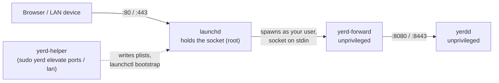

# yerd-forward (macOS ports)

`yerd-forward` is a tiny, unprivileged TCP relay that carries macOS ports 80/443 to the daemon's rootless ports. macOS has no `setcap`, so the rootless daemon ([`yerdd`](./yerdd)) can't bind the privileged ports itself. Instead `sudo yerd elevate ports` (and `elevate lan`) has [`yerd-helper`](./yerd-helper) install root-owned LaunchDaemons whose sockets make **launchd** bind 80/443; launchd then starts `yerd-forward` **as the invoking user** to serve them.

For the user-facing story see [Elevation & Privileges](../../guide/elevation#ports). This page is the contributor reference: how the socket is handed over, the module map, the invariants, and the threat model.

::: info One-line summary
`yerd-forward` is a std-only, no-`unsafe`, no-FFI relay that takes a listening socket from launchd on stdin, admits connections by scope, and copies bytes to the daemon's rootless port on the same local address. It never runs as root.
:::

## Where it sits



| Scope | launchd jobs | Bind | Installed by |
|---|---|---|---|
| `loopback` | `dev.yerd.ports.http`, `dev.yerd.ports.https` | `127.0.0.1:80` / `:443` | `sudo yerd elevate ports` |
| `lan` | `dev.yerd.lan.ports.http`, `dev.yerd.lan.ports.https` | `0.0.0.0:80` / `:443` | `sudo yerd elevate lan` |

The plists live in `/Library/LaunchDaemons` and are composed by `yerd_platform::pure::launchd_ports` (see [yerd-platform](../crates/yerd-platform#launchd-ports)). launchd loads them at every boot, so the forwarder persists without any boot script. No pf is involved, so other pf clients (OrbStack, Docker, Internet Sharing) can't break it and iCloud Private Relay keeps working.

Source: [`bin/yerd-forward`](https://github.com/forjedio/yerd/tree/main/bin/yerd-forward).

## Socket passing: `inetdCompatibility` `Wait`

Each plist sets `inetdCompatibility` `Wait = true`. In that mode launchd passes the **listening** socket (not an accepted connection) as the child's stdin, stdout, and stderr, and waits for the process to exit before it starts another. So taking the socket is just `stdin().as_fd().try_clone_to_owned()` into a `std::net::TcpListener`: no `launch_activate_socket` FFI, no `unsafe`. The plist has no `RunAtLoad` or `KeepAlive`; launchd holds the socket from load and spawns the forwarder on the first connection. `ProcessType` `Interactive` keeps launchd from throttling it.

Because stdout and stderr *are* the socket in this mode, the forwarder **never writes to them while serving**. Every write before that point uses `writeln!` with the result discarded, so a failed write can't panic.

## Command line

```text
yerd-forward --scope <loopback|lan> --to <port>
yerd-forward --version
```

Flags may come in either order; each must appear once, and `--to` must be a non-zero `u16`. The flag names are shared with `launchd_ports::FORWARDER_SCOPE_FLAG` / `FORWARDER_TO_FLAG`, and a test keeps them in step.

## Module map

| File | Responsibility |
|---|---|
| `src/lib.rs` | `parse_args`, `Scope`, the `admit` rule, `upstream_for`, and the `serve` / relay loop, all testable with plain loopback sockets |
| `src/main.rs` | Thin entry point: parse, root check, take the listener from stdin, call `serve` |
| `tests/contract.rs` | The plist `launchd_ports` composes parses back through `parse_args` (flags and scope values agree) |
| `tests/relay.rs` | End-to-end relay over real loopback sockets, including a non-blocking handed-over listener |
| `tests/no_runtime_deps.rs` | Dep-graph guard: no `tokio`, `reqwest`, `openssl`, `openssl-sys`, `native-tls`, or `rustls` |

Runtime dependencies are `yerd-core` (for `is_lan_source`), `thiserror`, and, on macOS only, `nix` (`user` feature) for the euid check.

## Behaviour

- **Admission (`admit`).** A peer must pass `yerd_core::is_lan_source` (loopback, `10/8`, `172.16/12`, `192.168/16`, `169.254/16`), the same source ranges the old pf LAN rule allowed. In `lan` scope a connection whose local address is loopback is also dropped: the wildcard listener would otherwise catch on-host traffic whenever the loopback jobs are absent.
- **Upstream (`upstream_for`).** Each connection is relayed to the **same local IP** it arrived on, at port `--to`. On the LAN listener that's `<lan_ip>:<rootless port>`, so after `yerd lan disable` (the daemon binds `127.0.0.1` only) LAN connections are refused rather than silently served, as with pf.
- **Relay.** One thread per connection, plus one for the return direction; `io::copy` each way with `TCP_NODELAY`, a half-close on clean EOF, and a full shutdown on error. The upstream connect has a 5 s timeout.
- **Blocking mode.** The listener and every accepted stream are forced blocking: launchd may hand over a non-blocking fd, and on Darwin accepted sockets inherit `O_NONBLOCK` from the listener.
- **Accept errors** back off 100 ms and retry; `serve` never returns on its own.
- **Client address.** It's a TCP relay, so the daemon sees the forwarder's connection, not the original peer. For LAN requests PHP's `REMOTE_ADDR` is the host's own LAN address rather than the client device's (pf `rdr` preserved it).

## Exit codes

| Code | Meaning |
|---|---|
| `0` | `--version` |
| `64` | Malformed arguments |
| `66` | stdin is not a listening socket (the binary was run by hand, not by launchd) |
| `74` | Setting the listener blocking failed |
| `77` | Running as euid 0: refused |
| `78` | Not macOS |

## Threat model

The forwarder sits on every request once ports are elevated, so the design keeps the privileged part in root-owned configuration and the running code unprivileged.

- **Root owns the plist, not the binary.** The plist is written by the helper into `/Library/LaunchDaemons` as `root:wheel 0644`, so only root can change `UserName` or `ProgramArguments`. The binary it names sits in the app bundle and may be user-writable, but launchd runs it as `UserName`, never root, so replacing it gains nothing that user didn't already have.
- **Never root.** The helper resolves `UserName` from the invoking uid passed as `--uid` (never from a string), and rejects uid `0` and any name that resolves to root. The forwarder also refuses to run with euid 0 (exit `77`). This is why `sudo yerd elevate ports` must be run via `sudo` from a user account, not from a root login.
- **Forwarder path checks.** The helper only names a `yerd-forward` that sits next to its own canonicalised executable, is a regular file with no group/world write bit, and isn't under `AppTranslocation` (a randomised mount that disappears after reboot) or `/Volumes` (an app run from its disk image, gone on eject).
- **No injection.** Every value interpolated into the plist is XML-escaped.
- **Minimal surface.** Plain std threads, no `unsafe` (`#![forbid(unsafe_code)]`), no FFI, no async runtime, no TLS: it copies bytes and never parses them.

Operational risks worth knowing: if the user turns off "Yerd" under System Settings ▸ General ▸ Login Items ▸ Allow in the Background, the jobs may not load; if the app is moved or deleted, the plists point at a missing binary until `sudo yerd elevate ports` is re-run.

## Building

`yerd-forward` builds on every OS (off macOS `main` exits `78`), so `cargo build --workspace` and the CI gate cover it. It ships only in the macOS app bundle, in `Yerd.app/Contents/MacOS/` next to `yerd-helper`. A source install on macOS must place it beside `yerd-helper` too (`cargo build -p yerd-forward`); see [Building from source](../building).

## See also

- [Elevation & Privileges](../../guide/elevation) - the user-facing model and the migration from pf
- [yerd-helper (privileged)](./yerd-helper) - installs and removes the launchd jobs
- [yerd-platform](../crates/yerd-platform) - `launchd_ports` (plist compose/parse) and `MacosPortRedirector`
- [Cross-Platform Model](../cross-platform) - how the macOS and Linux privileged-port paths differ
